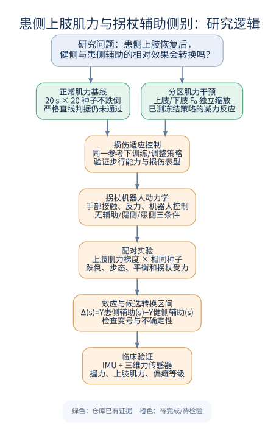
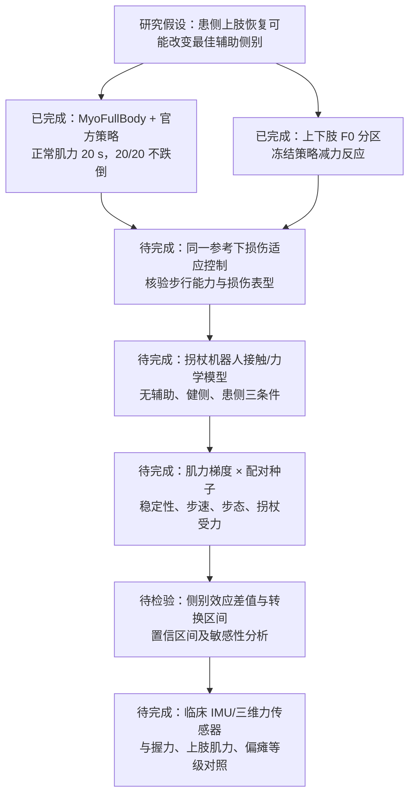

# 开题用研究逻辑图

研究问题：在偏瘫患者使用拐杖机器人的情境中，患侧上肢能力改变时，健侧辅助与患侧辅助对平衡和行走表现的相对效果是否发生转换？

下图将仓库已有证据与待开展实验分开。图可直接在支持 Mermaid 的 Markdown 编辑器中渲染，放入答辩 PPT 时建议使用同目录的 SVG。

控制与仿真的闭环可另用一句话概括：**当前状态和参考运动 → 策略输出肌肉控制 → 肌肉与地面接触产生力 → MuJoCo 积分得到下一状态 → 再次输入策略**。运动参考给出模仿目标，根节点在回合中不周期性覆盖。以后加入拐杖机器人时，手部接触、拐杖反力和机器人控制也要进入同一个动力学循环，才可以比较拐杖辅助引起的状态变化。

## 比较指标与转换点

设 \(s\) 为患侧上肢最大等长肌力的缩放系数，\(Y(s,c)\) 为在条件 \(c\in\{\text{无辅助},\text{健侧辅助},\text{患侧辅助}\}\) 下预先定义的平衡/步行综合指标。核心比较量是

\[
\Delta(s)=\mathbb E[Y(s,\text{患侧辅助})-Y(s,\text{健侧辅助})].
\]

只有当相邻肌力水平的配对比较支持 \(\Delta(s)\) 变号，且不确定性分析能排除随机种子、参考运动和接触参数造成的偶然交叉时，才报告候选转换区间。若没有可靠变号，则报告两种辅助方式的效应曲线，不强行给出临界点。指标应先明确方向和权重；跌倒率、步速、身体倾斜、足滑、拐杖反力建议分别报告，避免一个综合分数掩盖不良结果。

## 当前证据边界

- 正常肌力连续参考上 20 s 无跌倒为 [R 报告](../reports/R_continuous_gait_baseline.md)中的 20 个种子；严格侧偏判据为 0/20。拼接运动的接缝仍需单独检查。
- [P 报告](../reports/P_f0_upper_lower_ablation.md)的上肢/下肢减力采用另一段 10 s CMU 120 参考，且策略冻结。该结果用于验证参数化和策略敏感性；损伤后的稳定步态、拐杖辅助及转换点均待完成。
- \(F_0\) 缩放系数目前是模型参数，尚需通过临床握力、上肢肌力和偏瘫等级建立对应关系。0.35 m 侧偏阈值也不应直接写成临床安全界值。
